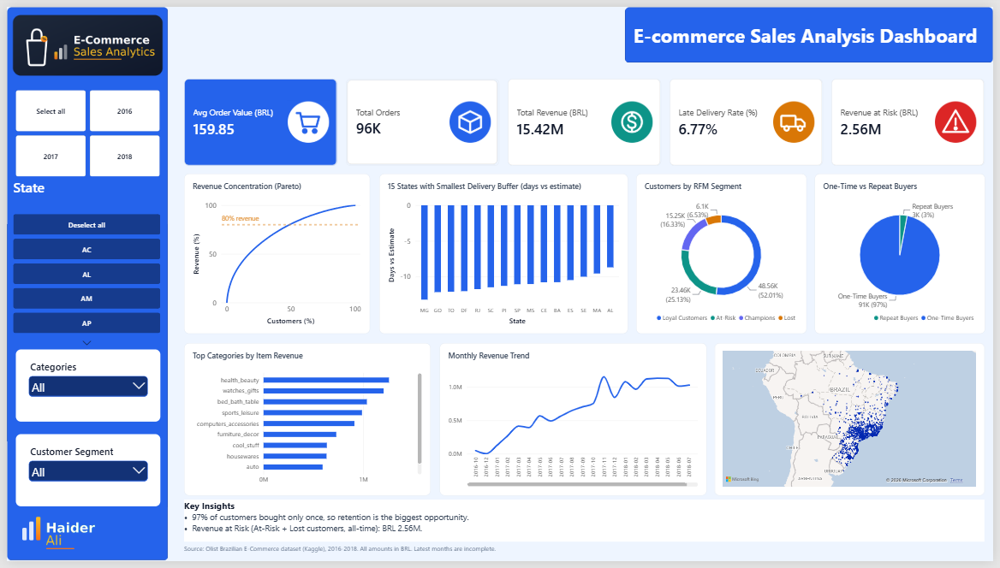

# E-Commerce Customer & Sales Analysis (Olist)

End-to-end analysis of ~100K Brazilian e-commerce orders: PostgreSQL for the SQL analysis, Python for RFM customer segmentation, and a Power BI dashboard for the business view.



## Business problem and goals

A marketplace wants to understand where its revenue comes from and where it is at risk. The analysis answers:

1. How large are revenue, order volume and average order value, and how did they develop over time?
2. Which customer segments matter most, and how many customers ever come back?
3. Which product categories generate the most revenue?
4. Where does delivery perform worst relative to the promised date?

## Tech stack and architecture

| Layer | Tool | Role |
|---|---|---|
| Storage | PostgreSQL (`ecommerce_db`, schema `public`) | Olist CSVs imported as tables |
| SQL analysis | `sql/analysis.sql` | Revenue trend, categories, delivery by state, repeat rate, revenue by customer quintile, sellers |
| Data science | Python 3.10 (pandas, NumPy, Matplotlib, Seaborn) | KPIs, RFM segmentation, charts, `rfm_segments.csv` |
| BI | Power BI Desktop (PBIP/PBIR project, DAX) | Interactive dashboard |

```
Olist CSV files -> PostgreSQL -> SQL analysis (sql/analysis.sql)
       |                |
       |                +--------------------------> Power BI (.pbip, live import from PostgreSQL)
       +--> Python (notebooks/analysis.py) -> RFM segments (data/rfm_segments.csv) -> Power BI
                                           -> charts (output/charts/*.png)
```

## Key findings

Basis: delivered orders only (96,478 of 99,441 orders), revenue = customer payments in BRL.

| KPI | Value |
|---|---|
| Total revenue | R$ 15.42M |
| Delivered orders | 96,478 |
| Average order value | R$ 159.85 |
| Unique customers | 93,358 |
| Late delivery rate | 6.77% (6,534 orders delivered on a later calendar day than estimated) |

**Retention is the biggest gap.** 97.0% of customers (90,557 of 93,358) bought only once; 3.0% (2,801) ordered again.

**RFM segmentation** (recency, frequency and monetary quartile scores, 1-4 each):

| Segment | Customers | Share of customers | Avg revenue per customer | Share of revenue |
|---|---|---|---|---|
| Champions | 15,247 | 16.3% | R$ 292 | 28.9% |
| Loyal Customers | 48,557 | 52.0% | R$ 173 | 54.5% |
| At-Risk | 23,457 | 25.1% | R$ 95 | 14.5% |
| Lost | 6,097 | 6.5% | R$ 54 | 2.1% |

**Revenue at Risk:** the At-Risk and Lost segments together account for R$ 2.56M, 16.6% of all-time revenue.

**Categories:** Health & Beauty (R$ 1.23M), Watches & Gifts (R$ 1.17M) and Bed, Bath & Table (R$ 1.02M) lead by item revenue. The top 10 categories make up 62.4% of item revenue (R$ 13.22M on delivered orders).

**Delivery:** across all delivered orders, parcels arrive on average 11.9 days before the estimated date, yet some states miss it far more often: Alagoas (AL) 21.4%, Maranhão (MA) 17.4% and Sergipe (SE) 15.2% late orders, against 6.77% overall.

**Trend:** monthly revenue peaks in November 2017 at R$ 1.15M (consistent with Black Friday); the last month with delivered orders, August 2018, reaches R$ 0.99M.

## Data quality notes

- **Fan-out bug (payments x items).** An order can have several items and several payment rows. Merging `order_payments` and `order_items` on `order_id` repeats every payment row once per item, so `SUM(payment_value)` rose to R$ 19.78M instead of the correct R$ 15.42M (about 28% too high). Fix: payments and items are never joined in one dataset. In Python, `df_revenue` (orders + payments + customers) and `df_items` (orders + items + products) are built separately; in SQL each query aggregates one of the two tables; in Power BI revenue measures sum `order_payments` and the category chart sums `order_items[price]`.
- **Reviews file.** The reviews CSV was cleaned before import (`olist_order_reviews_dataset_clean3.csv`).
- **Cross-checks.** Headline numbers (R$ 15.42M revenue, 96,478 orders, R$ 159.85 AOV, 6.77% late rate, R$ 2.56M revenue at risk) were reconciled between SQL, Python and Power BI.
- **Definition of "late".** The dashboard and Python count an order as late if it arrived on a later *calendar day* than the estimate (6.77%). Comparing full timestamps (as `sql/analysis.sql` query 3 does) classes more orders as late: 8.11% (7,826 orders).
- **Revenue basis.** Revenue is payments of delivered orders, which also cover freight; summed item prices (`price`) are lower (R$ 13.22M on delivered orders).

## Dashboard

File: `dashboard/pbip/ecommerce_dashboard.pbip` (Power BI project, PBIR format).

- **KPI cards:** Avg Order Value, Total Orders, Total Revenue, Late Delivery Rate, Revenue at Risk.
- **Filters (left panel):** Year, State, Category, Customer Segment.
- **Visuals:** Revenue Concentration (Pareto curve), 15 States with Smallest Delivery Buffer, Customers by RFM Segment, One-Time vs Repeat Buyers, Top Categories by Item Revenue, Monthly Revenue Trend, customer map of Brazil.
- **Key Insights box** with the two headline messages (retention, revenue at risk).

### DAX measures

Full definitions with explanations: [`dashboard/dax_measures.md`](dashboard/dax_measures.md).

| Measure | Table | Purpose |
|---|---|---|
| Total Orders | public orders | Distinct delivered orders |
| Total Revenue | public orders | Payments of delivered orders |
| : Avg Order Value | public orders | Revenue / orders |
| Late Delivery Rate % | public orders | Share of orders delivered after the estimated date |
| Avg Delay Days | public orders | Average days vs. estimate (negative = early) |
| Payment Row Count | public orders | Helper: payment rows |
| One-Time Buyers / Repeat Buyers | rfm_segments | Customer counts by frequency |
| Revenue at Risk | rfm_segments | Revenue of At-Risk + Lost customers |
| Repeat Buyer % | Geo Summary | Share of customers with more than one order |

## Repository structure

```
ecommerce-sales-analysis/
├── data/                  # raw Olist CSVs are not committed - see data/README.md
│   └── rfm_segments.csv   # generated by analysis.py, imported into Power BI
├── sql/analysis.sql       # 6 PostgreSQL queries
├── notebooks/analysis.py  # KPIs, RFM segmentation, 5 charts
├── output/charts/         # PNG charts written by analysis.py
├── dashboard/
│   ├── pbip/              # Power BI project (report + semantic model)
│   ├── dax_measures.md
│   └── dashboard_preview.png
├── requirements.txt
└── README.md
```

## How to run

**1. Environment**
```bash
python -m venv venv_sales
venv_sales\Scripts\activate          # Windows (macOS/Linux: source venv_sales/bin/activate)
pip install -r requirements.txt
```

**2. Data** - download the Olist dataset from Kaggle and place the CSVs in `data/` (filenames in [`data/README.md`](data/README.md)).

**3. Python analysis**
```bash
cd notebooks
python analysis.py
```
Prints the KPIs and RFM table, writes `data/rfm_segments.csv` and the charts in `output/charts/`.

**4. PostgreSQL**
1. Create a database named `ecommerce_db`.
2. Import each CSV into a table in schema `public` named `orders`, `order_items`, `order_payments`, `customers`, `products`, `sellers`, `order_reviews`, `geolocation`, `product_category_name_translation` (pgAdmin or DBeaver import wizard).
3. Run the queries in `sql/analysis.sql`. They compare date columns, so import them as `TIMESTAMP`.

**5. Power BI**
1. Open `dashboard/pbip/ecommerce_dashboard.pbip` in Power BI Desktop (enable the *Power BI Project (.pbip)* preview feature if asked).
2. Enter your PostgreSQL credentials when prompted (none are stored in the repository).
3. In *Transform data*, point the `rfm_segments` source to your local `data/rfm_segments.csv`, then refresh.

## Limitations

- The dataset covers 2016-2018 only (delivered orders from September 2016 to August 2018). Late 2016 months are very sparse and the latest months are incomplete, so trends at both ends should be read with care.
- All amounts are in Brazilian real (BRL); no currency conversion.
- No cost or margin data, so categories are ranked by revenue, not profitability.
- Almost all customers (97%) have a single order, so the RFM frequency score carries little information; segments are driven mainly by recency and monetary value. The scores are quartile-based and relative, not business-defined thresholds.
- With a category selected in the dashboard, revenue KPIs show the full payment of orders that contain that category, not the category's own share.
- Segment labels and the late-delivery definition (calendar days) are analytical choices documented above.

## Author

**Haider Ali** - M.Sc. Data Science, Berliner Hochschule für Technik (BHT), Berlin
LinkedIn: [linkedin.com/in/haiderali8237](https://linkedin.com/in/haiderali8237)

Dataset: [Olist Brazilian E-Commerce Public Dataset](https://www.kaggle.com/datasets/olistbr/brazilian-ecommerce) (Kaggle).
